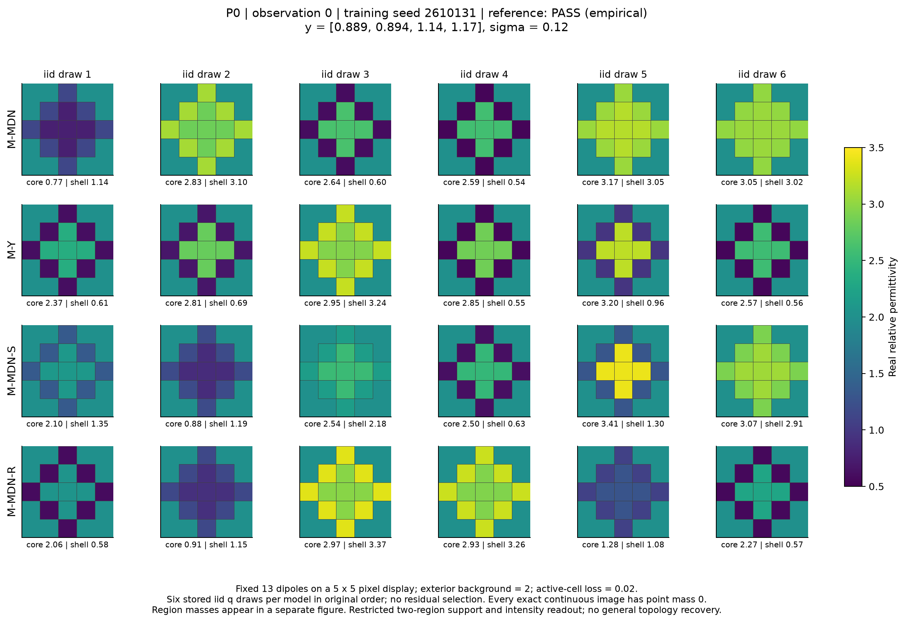
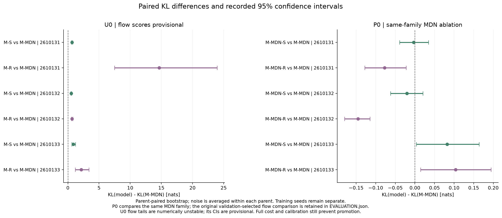

# C1 — Physics-State Probabilistic Generative Imaging

**最新研究：[C1-P1 密度修复报告](p1/C1_P1_RESEARCH_REPORT_ZH.md) · [逐模型/seed结果](p1/C1_P1_RESULTS.csv) · [下一步决定](p1/C1_P1_DECISION.md) · [完整下载](https://github.com/migodam/c1-physics-state-generative-imaging/releases/tag/c1-p1-2026-10-13)。** P0事件MAE约.0124、KL约.132；新U0仍约.0424/.166，state/memory无稳定优势。新增Maxwell/B1/GPU为0，继续小型density修复并等待匹配B1资产。

2026-10-13，统一、无预定义拓扑类别的材料概率生成研究与最小 CPU 实验。

**当前结果：生成器可以保留多个受限材料参数区域；事件概率误差约 5 个百分点；候选物理状态及记忆没有跨三个训练 seed 的稳定优势。保留统一材料生成方向，停止扩大当前 state/GRU 模型。**

- [从这里开始](START_HERE.md)
- [中文研究报告](C1_RESEARCH_REPORT_ZH.md)
- [方向 V2](C1_DIRECTION_V2.md) / [更新后的架构与实验规范](C1_ARCHITECTURE_EXPERIMENT_SPEC_V2.md)
- [下一阶段研究判断](C1_NEXT_DECISION.md)
- [代码](src/c1/) / [实验配置](configs/protocol_v2.json) / [已有测试](tests/)
- [逐 seed 结果](results/SUMMARY_METRICS.csv) / [逐 parent 结果](results/PARENT_METRICS.csv) / [概率校准表](results/CALIBRATION_TABLES.csv)
- [完整计算账本](C1_RESOURCE_LEDGER.json) / [物理求解记录](results/PHYSICS_LEDGER.jsonl) / [作业与失败记录](results/JOB_LEDGER.jsonl)
- [发布说明与文件选择](PUBLICATION_NOTES.md)
- [完整下载](https://github.com/migodam/c1-physics-state-generative-imaging/releases/tag/direction-v2-2026-10-13)

## 结果的适用范围

U0 是有连续参考分布的二维多模态逆问题。P0 是 13 个电偶极单元、两个连续材料系数、两源四个强度读数的 vector-DDA 原型。生成器不接收拓扑标签；候选状态只由测量与当前候选材料计算。MDN 的未标注混合成分是密度基函数，不对应预定义孔洞类别。

这些结果尚未验证任意形状、复杂边界、未知孔洞、一般连续 Maxwell 成像或真实测量。离散表示能画出孔洞的已有测试不构成生成恢复证据。输出是明确定义的条件分布 q 的样本与材料事件质量，尚未达到 posterior 校准目标。

三次 P0 训练中，memory 相对同 family 的 measurement-MDN 的 KL 差为 −0.0771、−0.1449、+0.1041；第三个 seed 方向相反。较弱的 flow 尾部失败不能用来夸大 state 增益。原始失败、参考细化和未解决的极端 U0 数值尾部均保留。

## 计算记录

本轮已完成的记录：24 次小模型 CPU 训练，7,961 / 8,192 次 material-frequency 求解；15,922 forward RHS、5,264 derivative RHS、4 adjoint RHS。记账 CPU 156.84 秒，作业 wall 178.74 秒，GPU 使用为零。交互写作和模型服务时间未完整计时，账本明确记录范围。B1 的实验、数据和 GPU 未被干扰；其不同 prior 的参考没有充当 C1 真值。

发布仅整理已有文件，没有新实验、训练或重算。历史测试和机器判断文件是已有研究记录。按照用户要求，发布和后续实验不额外引入 gate、SHA256 检查或 smoke test；必要的科学比较、数值误差与计算成本继续如实记录。

