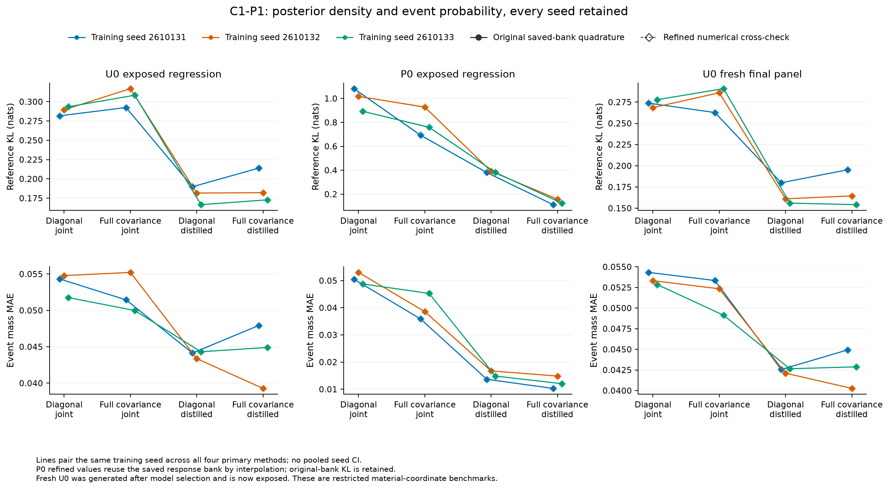
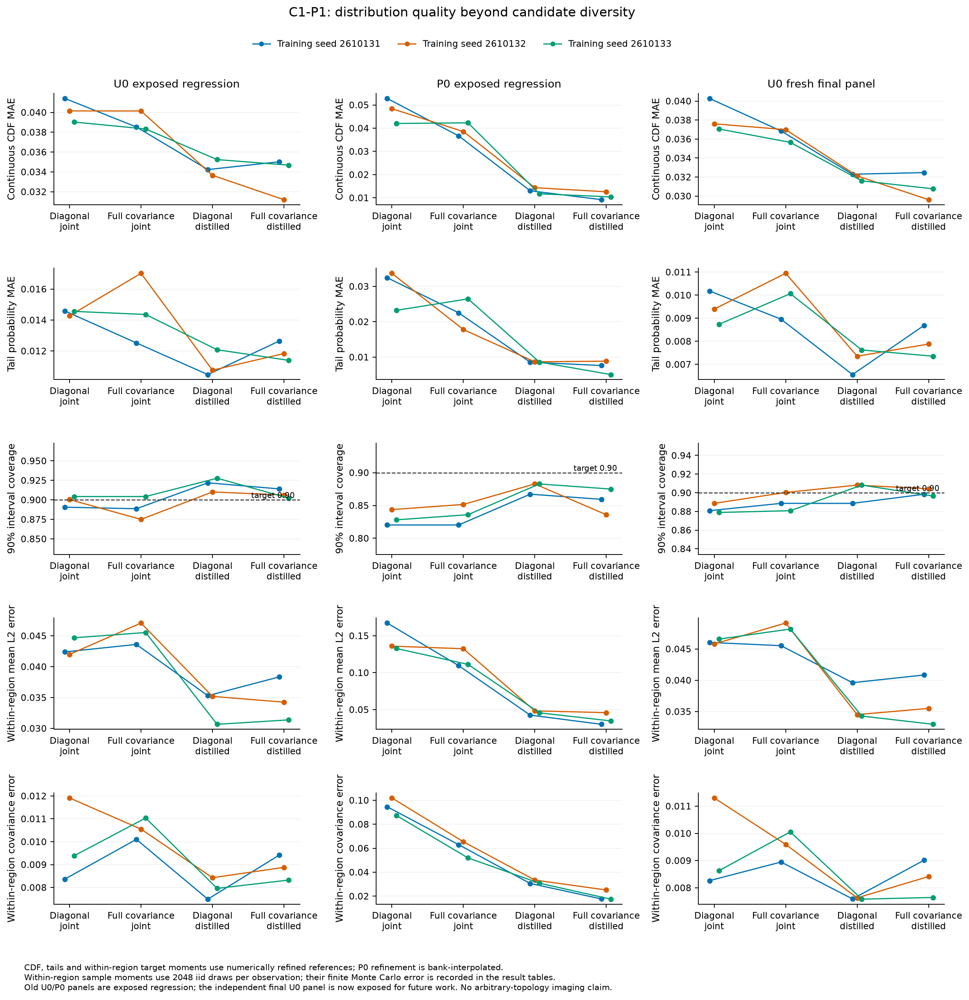

# C1-P1：统一材料 posterior 密度修复的研究与最小实验

2026-10-13。**P0 的材料事件概率得到明显修复：full-covariance posterior distillation 在三个seed的事件MAE为0.01031、0.01487、0.01205，参考KL为0.11241、0.15827、0.12556。完整posterior标准仍未达到；U0事件误差和数值尾部依然有明确失败；更强密度下的physics-state/memory仍无稳定优势。**

## 从散射歧义到材料概率

同一组散射读数可能允许多个材料解释。只生成不同图像，并不能说明它们各有多可信：必须定义同一个连续材料空间上的条件概率，再检查某些材料区域有多少概率、区域内部是什么形状、置信区间和尾部是否正确。单张精确连续图像的点概率为零，材料事件才有非零质量。

C1保留无预定义topology类别的共同材料support。当前原型只有两个连续材料坐标x∈(-1.5,1.5)²。U0是平方测量加弱线性读数的连续逆问题；P0是固定13个向量电偶极、两源四个intensity readout、core/shell两个材料系数。epsilon=2+x+i0.02、mu=1。它们不是任意未知边界/孔洞的Maxwell成像，不是B1的三模板Mie目标。

先验为proper product exponential tilt，a=(0.4,-0.2)。读数使用同一份实Gaussian likelihood，完整目标为

\[
p(x|y)=p_0(x)L(y|x)/Z(y),\quad L\propto\exp[-\tfrac12\|(F(x)-y)/\sigma\|^2].
\]

网络q是这个posterior的normalized近似，输出iid条件样本与q的材料事件质量。没有residual softmax、重复likelihood、best-of-K评价或最终GN投影。所有sign partition只在生成后评价，8个mixture component没有类别身份。原C1理论、文献结论和成本保留；本阶段没有重做宽泛文献综述或提出MDN/distillation的新颖性主张。

## 先读已有证据，再区分原因

完整读取指定报告、规范、旧代码/config/reference审计/账本。机械代理逐一完整读取154个证据文件，抽取24模型、216条checkpoint历史和2304条parent指标，见[读取回执](research/delegated/artifact_audit/READ_RECEIPT.json)。其证据由主Codex解释。

P0原9次MDN家族训练8次选择250步、1次500步，均远早于3000。训练batch NLL持续下降、validation NLL却恶化；例如旧measurement-MDN首seed validation NLL_z从3.306升至32.960。这支持过拟合/泛化问题存在。U0多数运行选择最后1500步，不能套用同一解释。normalization只fit train；没有发现把test统计写入输入归一化的证据。

旧joint-sample NLL在总体上是正确的：E_{p(x,y)}[-log q(x|y)]等于E_y posterior交叉熵。精确logit Jacobian对模型参数是常数，因此旧NLL_z本身不是错误posterior目标。问题可能来自有限材料监督、摊销映射、优化和表示能力。不能把distillation改善解释为“旧likelihood错了”。

## 两项改动，四个公平对手

实施diagonal/full covariance × joint/distillation的2×2，而不是机械加入多种网络。保留未标注diagonal MDN；full covariance增加每component的相关系数rho=.995 tanh(raw)。真实参数约30042/29966，state/memory也以有效encoder宽度匹配约30k，没有padding。

所有方法同conditioning observations、proper prior/support、三个seed2610131/2/3、Adam1e-3、batch128、每250更新记录checkpoint；U0 1500更新，P0 3000。所有P1方法以同一validation posterior-expected material NLL选checkpoint，并保留observed真材料NLL选择记录。旧冻结MDN另外作为历史锚点。P0的新joint baseline仍选250步，并与历史模型重评结果相同；U0部分checkpoint变动，不能将这部分改善归于新density。

Distillation使用同一y下的参考积分目标：节点质量正比于quadrature volume × p0(x_g) × L(y|x_g)。随机采节点优化该连续积分近似的NLL。节点不是离散材料先验。训练教师不进入生成器推断。**这不是相同监督信息量的纯架构比较：distillation利用已知forward bank增加posterior监督，并减少conditional target Monte Carlo噪声。** conditioning数据与网络预算匹配，教师信息和历史物理成本另列。

材料logit z=log(x+1.5)-log(1.5-x)，q_x=q_z×prod_j 3/[(x_j+1.5)(1.5-x_j)]。softmax混合权、严格SPD协方差和该Jacobian给出正确归一化连续密度。独立SciPy logpdf、密度积分、变换、相关采样及接口测试已执行；这不是posterior校准成功证明。

## 参考误差和模型误差分开

P0始终只读已有40/64 response bank，新Maxwell调用为0。初始preparation在全部train/validation发现40/64事件差最大.00341，但CDF差.0375、quantile差.1424、tail差.0356，部分量未稳定。不能直接当模型误差。

在任何新训练之前，登记第二轮数值诊断：两银行各自拟合degree8/12 tensor Chebyshev response，跨银行检查，并用96/128积分核对。degree12跨银行响应最大差8.14e-9，两独立拟合的posterior事件差最大7.54e-11。train/validation的96/128 CDF差最大4.49e-4，事件差1.44e-6，quantile差1.78e-4。它是原forward的数值近似，不改变prior/support/likelihood，也没有全域或continuum误差证书。

64-node训练教师没有替换；原40/64指标全部保留。主要KL与事件表仍用原64 bank；同时报告refined128 KL。P0 test panel两者事件差≤1.66e-5，refined CDF细化差≤9.85e-6。full-distill三seed KL在原/refined参考上分别0.112413/0.112786、0.158266/0.158663、0.125560/0.125885。改善方向不依赖换参考。U0直接计算解析likelihood，96/128最终新panel事件差≤2.55e-12，CDF细化差约3.45e-5。

事件概率采用Gaussian mixture CDF。diagonal为CDF乘积；full covariance使用Plackett相关积分，32/64阶与独立conditional-normal积分核对。这样不再把1024 draw的事件频率误差混入主排名。矩、quantile、CDF、tail与参考精度分别记录。within-region均值/协方差为2048 iid draws的诊断，保留Monte Carlo误差，不把它当精确oracle。

## 固定评价结果

旧U0/P0 test均为exposed regression panel。U0新256 parents×1 noise在所有主要模型选定后才按预先保存seed26101351生成，只做一次最终评价；它现在也已曝光，未来不能再称blind。P0没有新的盲Maxwell参考。

下面是三个seed描述性均值，不能当作独立测试集或合并seed置信区间。KL、MAE、参考区间内容误差越小越好；coverage为两个坐标各自90%区间的平均覆盖，不是joint 90% rectangle。

### P0：exposed regression

|模型|KL|事件 MAE|CDF MAE|90%坐标覆盖|区间参考内容误差|tail MAE|
|---|---:|---:|---:|---:|---:|---:|
|diag_joint|0.996777|0.050736|0.047732|0.830729|0.053977|0.029799|
|full_joint|0.793003|0.039917|0.039179|0.835938|0.046566|0.022271|
|diag_distill|0.384261|0.015089|0.013057|0.877604|0.012291|0.008616|
|full_distill|0.132080|0.012409|0.010740|0.856771|0.010919|0.007187|

full-distill相对matched diagonal-joint的parent配对KL差为−.96821、−.85897、−.76692，95%CI分别[-1.07735,-.86235]、[-.95318,-.76316]、[-.89453,-.63570]。事件MAE差为−.04013、−.03815、−.03670；proper真材料NLL改善的三个CI也排除零。模型改善不是只看一个seed。

三个事件MAE都低于.02，但KL都高于.02，p95最大事件误差为.03934/.05763/.05735，后二者高于.05。经验坐标覆盖约.857，未达到完整概率目标。coverage的parent-bootstrap CI分别[.79688,.91406]、[.77324,.89844]、[.81250,.92969]，64个parent的波动不能忽略。参考计算的CI内容误差约.011表明conditional区间已有改善，但不能把有限panel的整体覆盖差全解释为数值或模型误差。

### U0：新独立final panel

|模型|KL|事件 MAE|CDF MAE|90%坐标覆盖|区间参考内容误差|tail MAE|
|---|---:|---:|---:|---:|---:|---:|
|diag_joint|0.273377|0.053501|0.038317|0.882812|0.041459|0.009437|
|full_joint|0.279852|0.051605|0.036499|0.889974|0.041296|0.009990|
|diag_distill|0.165703|0.042439|0.032007|0.901693|0.033697|0.007179|
|full_distill|0.171336|0.042692|0.030949|0.899740|0.033248|0.007973|

diagonal-distill相对joint的三seed KL差为−.09377、−.10741、−.12184，parent CI全部低于0；事件MAE改善约.010–.012，proper observed NLL也稳定改善。然而事件MAE仍约.042，p95约.19–.20。full covariance单独不稳定，distill中也没有明显优于diagonal。full covariance不是所有物理逆问题的必选答案。

新U0中κ=0的diagonal-distill事件MAE约.0310；κ=.25约.0508；κ=.6约.0436。误差既存在于歧义区域，也存在于较强likelihood条件，不宜只解释为先验造成的不可辨识性。

## Q1：失败的主因能否区分

**P0有两个可区分因素。** 换full covariance但保留joint监督，平均KL从.997降至.793；在相同diagonal family换成distillation，降至.384；二者结合降至.132。这支持covariance表示和监督/泛化都有贡献。训练验证趋势也支持joint有限样本过拟合。不能由此单独证明样本数、optimizer或encoder容量的唯一因果比例。

固定前8个validation观测、两次无sign初始化、60步weighted EM，仅作非摊销参考拟合诊断。在独立fine reference上的平均KL：U0 diagonal/full约.00733/.00715，摊销distill对应约.184/.207；P0约.37610/.07401，摊销distill对应约.456/.154。**U0的同family可以在这些固定观测拟合得很好，主要缺口是摊销映射/优化而非diagonal covariance；P0的diagonal geometry确有局限，full covariance仍有摊销缺口。** EM使用观测的reference监督，不是可部署generator，也不是全域最优或表示误差下界。

KL按sign区域分解为event-mass KL加weighted within-region KL。P0 full-distill的.13208中event部分约.00333、within-region约.12875；diagonal-distill为.00437+.37989。模式质量改善后，剩余大头是区域内部shape/tails。U0 diagonal-distill为.04552+.12018，事件质量问题仍真实存在。参考、finite panel与生成样本误差分别保留，见[配对结果](C1_P1_PAIRED_RESULTS.csv)、[不确定性](results/UNCERTAINTY.json)。

κ=0时平方likelihood在每个符号反射下不变。给定幅值r，sign odds来自prior的exp(2a_j r_j)；counterfactual flat-prior积分的四事件质量在1.97e-15内都是.25。原tilt prior使质量不等，同时读数仍约束材料幅值。full posterior相对prior平均KL约2.777 nats，event KL约.0165，说明“歧义来自先验”不能理解为测量没有信息。没有证据证明当前.04–.05事件误差已经到达统计下限；教师积分精度远小于该误差，distillation和固定观测EM都说明存在可改善空间。

## Q2：稳定归一化密度有进展，tail repair尚未完成

P0 full-covariance distillation在三个seed的KL、事件质量、CDF和区域内geometry均明显改善。tail MAE约.00719，对比joint约.02980；mean/variance/quantile MAE由约.1059/.0975/.1341降到.0250/.0232/.0376。重要事件log-odds MAE由约.345降到.081。diagonal-distill的经验coverage略高于full-distill；不能把full covariance描述为所有指标都赢。

U0也有stable distillation改善，但没有达到可靠完整posterior。所有主要网格点的log density有限，模型数学归一化；数值材料积分平均接近1，仍需保留每案例积分误差。未稳定的旧Flow KL没有参加排名。

**float64并未消除U0支持边界问题。** 部分新模型仍采到abs(z)>37的极端tail，float64 sigmoid会舍入到±1.5；本轮观察到最大abs(z)约83.5，按model/seed在整panel平均的endpoint rounding fraction最大约1.53e-5。P0本轮为0。保留原z和饱和输出，不clip或重抽样；未把logit理论密度的正确性称为完整数值采样成功。新RNG/样本数不同，不把新计数与旧156/7直接作配对比较。详细[数值限制](results/SAMPLING_NUMERICAL_LIMITS.json)，[原始负例](results/TAIL_FAILURE_DRAWS.json)保留26个已记录失败观测的46个draw；最初流式评价只存计数，使用相同冻结模型/RNG补全，没有新设计或重排结果。

## Q3：更强density下，state仍无稳定实际价值

按事先记录的触发条件，P0 measurement repair三个seed均改善后，以validation平均expected score选中的full-distill做一次缓存特征消融。同family、同teacher/数据/steps、近似同容量，没有新online solve或candidate-specific refresh。

|seed|measurement KL|state KL|memory KL|state−measurement|memory−measurement|
|---|---:|---:|---:|---:|---:|
|2610131|.112413|.131424|.136098|+.019011|+.023685|
|2610132|.158266|.133872|.114390|−.024395|−.043876|
|2610133|.125560|.156085|.132301|+.030525|+.006741|

这六个KL差的parent 95%CI均排除0，但方向是一seed改善、两seed恶化；memory事件MAE三个seed均恶化。平均memory KL约3.4%改善不能替代跨seed稳定性。没有实际cost优势证据，因此状态实验停止。所有state来自已保存candidate+y，不增加独立测量或重复likelihood。

此次cache读取新增物理成本0。若未来新query按旧uncached pilot准备，仍需2 material-frequency/12 RHS；固定anchor有潜在cache优化，尚未实现，不能称这个数是不可改善下界。共同float64推断计时记录encoder+1024样本和1024点density；measurement full-distill前者约.15–.42ms、后者.29–.48ms。cached state时间不含新物理准备，不能以神经时间宣称端到端获胜。完整训练、验证、参考、评价和失败计入独立账本。

## Q4：B1共同benchmark的条件

[最小接口](C1_B1_INTERFACE.md)与[c1p1/benchmark.py](c1p1/benchmark.py)已实现，表达latent/field/support/base measure/proper prior、noise/nuisance/acquisition、惰性solver adapter、连续density/samples/quadrature reference、事后events、candidate features与成本。观测、prior、likelihood、solver和实际numerical target必须匹配；integration volume与posterior mass分开。真实C1只读接入函数saved_p0_benchmark可运行，接口测试不触发forward。

B1主仓库现有正式定义仍是三模板Mie/complex field，不能与P0直接比。只读下一阶段package见统一径向四参数建议，未找到完整冻结B1-2 prior/likelihood/solver/reference；不假设进行中的实验成功。尚缺正式统一latent维度/支持/先验、noise/nuisance边缘化、matching solver资产、独立reference误差与曝光定义、允许复用的bank及成本。当前C1 density head仅2维，未来还需按最终latent扩维和重新训练。

因此接口接入能力已建立，直接科研比较仍未成立。没有运行B1代码、读取其数组、修改其环境/文件、抢占GPU或重做其forward。

## 计算与下一步

独立P1注册30次小模型训练：24 primary +6 cached ablation，共72000 optimizer updates；两个有限诊断均完成，没有增加模型族/训练时长。新增Maxwell/B1/GPU均0，单CPU worker、BLAS threads1、nice15。已有C1/B1账本未改。

最终受控费用：测量CPU 262.434009s，加预留后 272.434009/900s；测量job wall 276.954867s，加预留后 291.954867/1800s。以 [C1_P1_RESOURCE_LEDGER.json](C1_P1_RESOURCE_LEDGER.json) 为准：已完成30次小训练、两轮有限诊断、必要概率与接口测试；新增Maxwell/B1/GPU均0。上限始终900 CPU/1800 wall，10 CPU/15 wall保守预留覆盖静态整理与最后封存开销。51个不同测试通过，guard修订后的一项重复执行；不是未知拓扑或posterior校准接受。

历史P0 reference bank的5696 material-frequency/11392 forward RHS已在原C1支付，当前重用不重新收费，也不称教师免费。当前阶段成本不能替代从零建立新benchmark的全部成本。交互阅读/写作/模型服务/代理推理及网页服务时间未完整计入受控CPU/wall，不声称研究只花了几分钟。

**下一步选择A+C：继续低成本、统一normalized density与支持研究，并等待B1匹配资产。** P0保留full-covariance distillation，U0保留更简单的diagonal-distillation认真对照。优先针对amortization、边界tail和within-region geometry；可考虑support-native bounded spline/autoregressive density或proper prior-defensive mixture，但它们本阶段均未实现，不能宣称有效。未来改动仍要保持同target、proper log score、同conditioning数据与独立成本。

**NO-GO重新扩大当前Physics-State/GRU路线；NO-GO完整posterior已校准的主张。** 不启动大型GPU、Attention/Diffusion、OPM sweep、candidate-specific多轮physical refresh。一般未知拓扑成像、continuous Maxwell convergence、真实测量与B1共同target实验均未运行。

## 文件与重现

逐模型/seed结果：[C1_P1_RESULTS.csv](C1_P1_RESULTS.csv)；配对差异：[C1_P1_PAIRED_RESULTS.csv](C1_P1_PAIRED_RESULTS.csv)；费用：[C1_P1_METHOD_COSTS.csv](C1_P1_METHOD_COSTS.csv)。完整观测、参考误差、训练history、已有权重和job回执在results中。配置、原始登记与调整在configs和本目录诊断记录。

运行代码依赖原C1仓库的src、已公开的数据、response bank与历史权重。重现须复制P1代码/config到同一C1根下新的独立目录，保留旧结果和账本，为新运行登记新上限；不能删除账本在已完成p1目录偷偷开始第二遍。teacher_cdf.npy是可从公开bank和代码重建的cache，未放入公开包；新读取/建立都需记账。

本阶段没有SHA256或smoke，没有新执行/发布gate。科学质量目标与失败如实保留。
